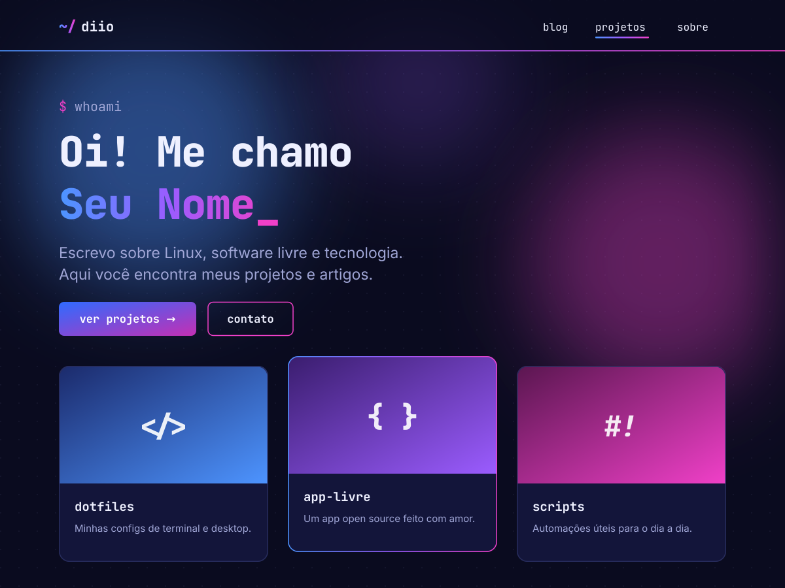

# diio_WP_theme

Tema de blocos para WordPress com estética de terminal, em azul e fúcsia, para sites pessoais com **blog** e **portfólio de projetos**. Escuro por padrão, com modo claro opcional.



## Recursos

- Tipo de conteúdo **Projetos** (`/projetos/`) com status, ano, papel, tecnologias (`/tecnologia/nome/`) e links para o projeto e o código-fonte
- Miniatura do projeto com imagem destacada ou um dos 23 ícones incluídos, em 4 cores de fundo
- Tela **Projetos → Configurações** para renomear campos, status, botões e o título da seção
- Página inicial com apresentação, projetos recentes, posts recentes e contato
- Blocos próprios: miniatura, texto do card e informações do projeto
- Estilo de bloco **Terminal** para o bloco Grupo
- Modo claro com botão sol/lua e transição em círculo; a escolha fica salva no navegador
- Animações (entrada ao rolar, digitação, cards 3D, barra de leitura, 404 com glitch e um easter egg), desligadas para quem usa "reduzir movimento"
- Fontes Inter e JetBrains Mono embutidas; sem jQuery, sem scripts externos, sem cookies

## Requisitos

- WordPress 6.6+ (testado no 7.1)
- PHP 7.4+ (testado no 8.3)

## Instalação

1. Baixe o repositório como .zip (**Code → Download ZIP**) ou baixe o .zip da [última release](../../releases/latest).
2. No WordPress, vá em **Aparência → Temas → Adicionar novo tema → Enviar tema** e envie o arquivo.
3. Ative o tema.
4. Crie as páginas **Início** e **Blog** e, em **Configurações → Leitura**, escolha "Uma página estática" com Início como página inicial e Blog como página de posts.
5. Edite seu nome, textos e links em **Aparência → Editor** e cadastre projetos no menu **Projetos**.

Se baixar pelo botão "Download ZIP", a pasta vem com o nome `diio-wp-theme-main`. Funciona assim mesmo, mas é recomendável renomeá-la para `diio-wp-theme`.

## Estrutura

```
style.css            cabeçalho do tema + CSS
theme.json           paleta, fontes, tamanhos e estilos
functions.php        setup, assets, modo claro
inc/                 portfólio (tipo de post, campos, blocos) e tela de configurações
templates/ parts/    modelos de blocos
patterns/            padrões em PHP (hero, projetos, posts, contato, rodapé)
assets/              CSS do admin, JS, fontes e ícones
```

## Licença

O código é distribuído sob a [GNU GPL v2 ou posterior](LICENSE).

- Inter e JetBrains Mono: SIL Open Font License 1.1
- Ícones Lucide: ISC
- Ícone Linux (Simple Icons): CC0

Detalhes em `readme.txt` e nas licenças em `assets/`.
